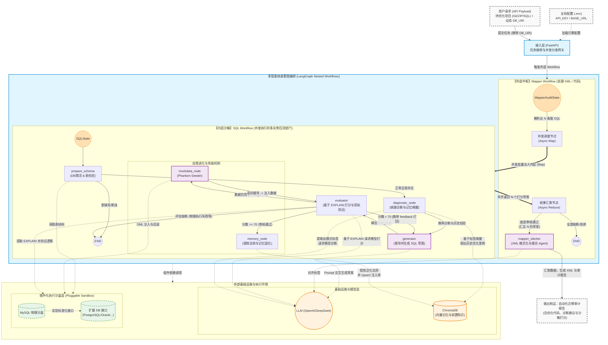

<!-- 如果你有 Logo，可以取消下面这行的注释并替换路径 -->
<!--  -->

# Agentic-DB

**一个带“物理沙箱”和“记忆库”的多智能体 SQL 优化系统**

## 🛠 前置环境与运行时拦截机制

在任务启动前，Agentic-DB 具备严格的配置要求与防故障拦截机制：
1. **全局环境配置**：系统底层依赖 `.env` 文件加载 LLM 引擎的全局参数（如 `OPENAI_API_KEY`、`BASE_URL`、`LLM_MODEL` 等）以激活推理大脑。
2. **动态沙盒注入**：物理沙盒的连接凭证 (`DB_URI`) 并非全局写死，而是由用户在调用 FastAPI 提交任务时动态传入。这使得系统原生支持多数据源切换与并发审计任务。
3. **前置探活与表校验**：在任何 LLM 消耗 Token 开始优化前，系统的主动探针会第一时间测试用户传入的 `DB_URI` 的连通性，并从沙盒中核实待优化 SQL 关联的表结构是否真实存在。若物理表缺失或无法连接，系统将立即**熔断并出具高危拦截报告**，避免无效的“大模型幻觉”。

## 🚀 架构图

Agentic-DB 采用 **Neuro-Symbolic Agentic Engine**（神经符号智能体引擎）架构，将大模型（LLM）的非确定性推理与 LangGraph 的确定性嵌套状态机、AST 解析以及 MySQL 物理沙盒深度结合。系统不仅输出语法转换后的可用代码，还会生成详尽的**自动化迁移审计报告（包含沙箱打分、高危拦截原因与 SQL 诊断建议）**，旨在保障企业级代码迁移与 SQL 重构的 100% 准确性。

